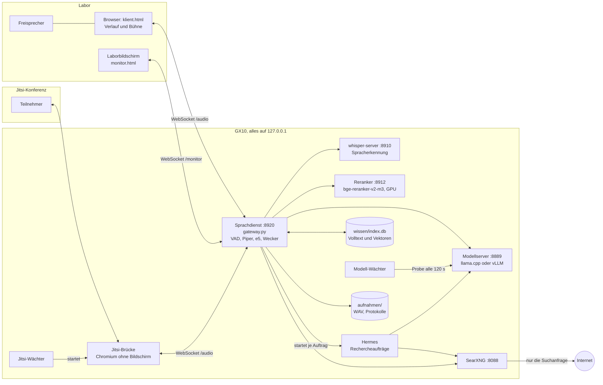
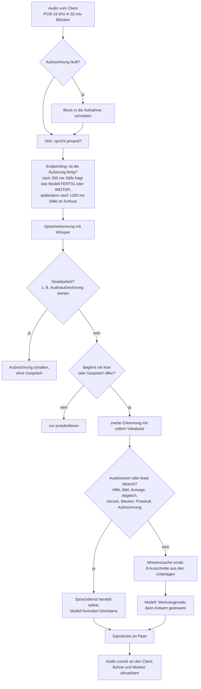
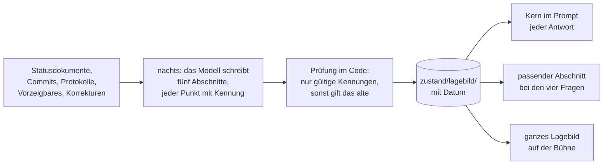
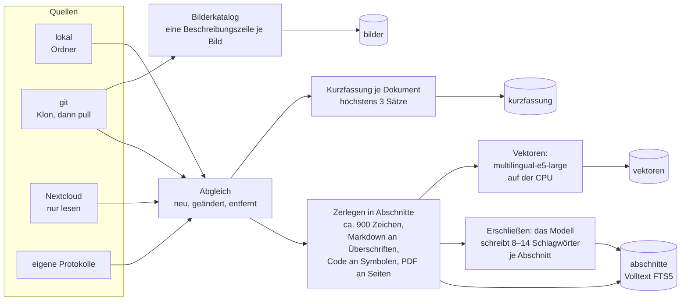
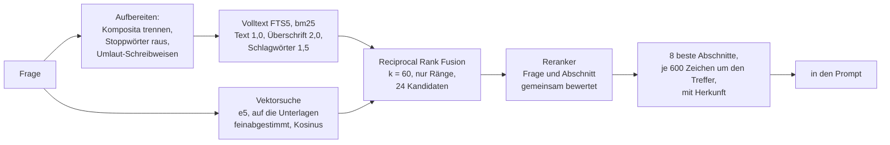
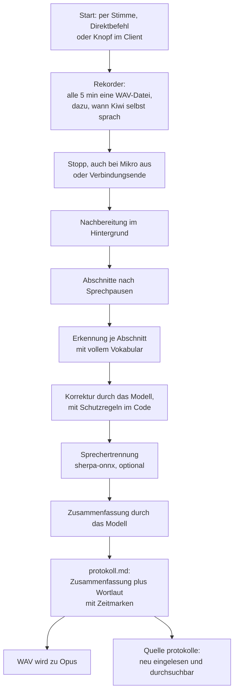
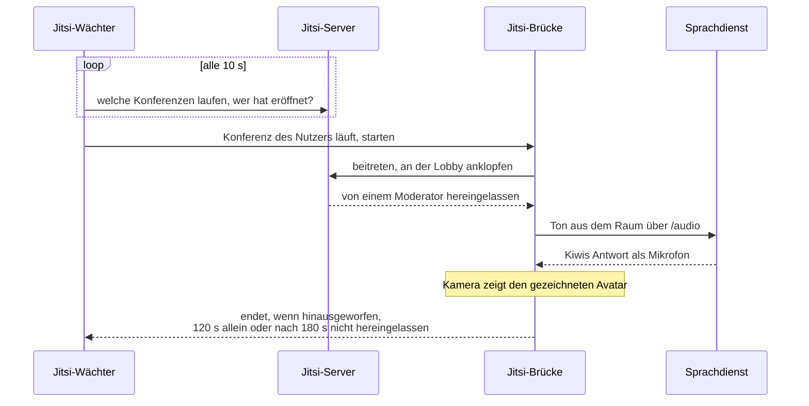

# kihiwi — Architektur

Wie Kiwi aufgebaut ist: welche Dienste es gibt, wie sie verbunden sind, was bei
einer gesprochenen Frage passiert und wie aus Unterlagen durchsuchbares Wissen
wird. Diese Seite ist die Übersicht. Messwerte, Fallen und die Begründungen
stehen in [technisch.md](technisch.md), die Begriffe in [GLOSSAR.md](GLOSSAR.md),
der Verlauf in [entwicklung.md](entwicklung.md).

Stand: November 2026. Die Grafiken sind Mermaid und werden auf GitHub direkt
gezeichnet.

## Auf einen Blick

Alles läuft auf einer Maschine (GX10) und spricht nur über `127.0.0.1`
miteinander. Im Labor stehen ein Rechner mit Browser, Freisprecher und
Bildschirm; sie erreichen den Sprachdienst über einen SSH-Tunnel. Der
Sprachdienst ist der einzige, der alles kennt: Er nimmt Audio an, entscheidet,
was zu tun ist, und fragt die übrigen Dienste.

| Dienst | Adresse | Gestartet von | Aufgabe |
|---|---|---|---|
| Sprachdienst | `127.0.0.1:8920` | `./dienste.sh start` | Audio, Turn-Taking, Entscheidungen, Sprachausgabe, Wissenssuche |
| whisper-server | `127.0.0.1:8910` | `./dienste.sh start` | Spracherkennung (whisper.cpp, large-v3-turbo, Deutsch) |
| Reranker | `127.0.0.1:8912` | `./dienste.sh start` | ordnet die Kandidaten der Wissenssuche neu (llama.cpp `--reranking`, Prozessname `kihiwi-rerank`) |
| Modellserver | `127.0.0.1:8889` | `model-switch <profil>` | ein großes Sprachmodell, OpenAI-kompatibel; Vorgabe Nemotron-3.5-Super auf vLLM |
| SearXNG | `127.0.0.1:8088` | eigener Container | Websuche, einziger Weg nach außen |
| Hermes | kein Port | Sprachdienst, je Auftrag | Agent für längere Rechercheaufträge |
| Jitsi-Brücke | kein Port | Jitsi-Wächter oder `./dienste.sh jitsi start` | Kiwi als Konferenzteilnehmer |
| Jitsi-Wächter | kein Port | `./dienste.sh jitsi auto start` | klopft bei Konferenzen eines Nutzers an |
| Modell-Wächter | kein Port | `./dienste.sh waechter start` | startet den Modellserver neu, wenn er nicht mehr antwortet |

Im Sprachdienst selbst laufen, ohne eigenen Dienst: Silero-VAD (Spracherkennung
an/aus), Piper (Sprachausgabe), das Embedding-Modell multilingual-e5-large
(Vektoren für Fragen), die Wecker und die Messwerte für die Anzeigetafel.
`model-switch`, whisper.cpp, Hermes und SearXNG liegen außerhalb des Repos.

## Eine Frage, Schritt für Schritt

Der Sprachdienst entscheidet selbst, was er ohne Modell kann, und fragt das
Modell erst, wenn es formulieren oder abwägen muss. Was sich deterministisch
erledigen lässt, entscheidet der Code: Uhrzeit, Wecker, Aufzeichnung,
Wissensabgleich, Bildanzeige. Das Modell wird dann gar nicht gefragt.

**Zwei Prompts.** Das Modell bekommt für die Werkzeugrunde einen kurzen,
neutralen Prompt mit Datum, Uhrzeit und Aufnahmestand. Die gesprochene Antwort
entsteht danach neu, auf einer sauberen Nachrichtenfolge aus Frage und
Werkzeugergebnissen, mit dem Sprechstil-Prompt (höchstens zwei Sätze). Der
Grund: Ein Sprechstil-Prompt unterdrückt Werkzeugaufrufe.

**Werkzeuge je Absicht.** Bei einer Frage an die Unterlagen sucht der Dienst
selbst. Findet er etwas, bekommt das Modell keine Werkzeuge, sondern nur die
Ausschnitte mit der Anweisung, sich daran zu halten. Findet er nichts, bleiben
`web_suchen` und `unterlagen_ueberblick`. Rechercheaufträge laufen über
`rechercheauftrag`, die Aufzeichnung über `aufzeichnung`.

**Sicherheitsnetze danach.** Lehnt das Modell ab, obwohl ein Werkzeug passte,
behauptet es eine Aufzeichnung, ohne sie zu schalten, oder verspricht es eine
Recherche, holt der Dienst den Werkzeugaufruf erzwungen nach. Kommt gar nichts,
sagt Kiwi das.

**Zeitbudget** (warm gemessen, Einzelheiten in [technisch.md](technisch.md)):

| Schritt | Zeit |
|---|---|
| Spracherkennung | ~100 ms |
| erstes sprechbares Satzstück des Modells | 350–670 ms |
| erstes Stück Sprachausgabe | 120–270 ms |
| Endpointing | 490–1450 ms |
| **Ende der Frage bis erster Ton** | **1,1–2,3 s** |

## Wissensverarbeitung

Vier Stufen, je nachdem, was gefragt ist:

| Stufe | Wann | Wie schnell |
|---|---|---|
| 0 | Plaudern, Allgemeinwissen | sofort, nur das Modell |
| 1 | Projektstand: Stand, Nächstes, Probleme, Vorzeigbares | etwa 1 s mehr, aus dem Lagebild |
| 2 | eine bestimmte Stelle in den Unterlagen | Sekunden, Wissenssuche |
| 3 | gründliche Recherche | Minuten, Hermes auf Anweisung |

### Das Lagebild

Korrekturen per Stimme gelten sofort und fließen in jedes folgende Lagebild
ein, bis eine neuere Quelle das Thema aufgreift, höchstens zwei Wochen.
Einzelheiten und Messwerte in [technisch.md](technisch.md).

Kiwi beantwortet Fragen aus den Unterlagen des Labors. Dafür werden die Quellen
regelmäßig abgeglichen, in Abschnitte zerlegt und auf zwei Wegen durchsuchbar
gemacht: über Volltext mit vom Modell erzeugten Schlagwörtern und über
Vektoren. Beides wird bei der Suche zusammengeführt.

### Vom Dokument zum Index

- **Abgleich** per Stimme („Wissensabgleich“) oder mit
  `./dienste.sh wissen einlesen`. Unveränderte Dateien erkennt ein
  Fingerabdruck und überspringt sie.
- **Erschließen und Vektoren** sind teuer. Nach einem Abgleich zieht der Dienst
  sie im Hintergrund nach, aber nur bis 300 neue Abschnitte. Sind es mehr, sagt
  Kiwi das, und „Wissen nachziehen“ holt es ohne Grenze nach.
- **Schlagwörter hängen am Inhalt**, nicht an der Datei (Schlüssel ist ein Hash
  des Abschnitts). Wird eine Datei neu eingelesen, bleiben die Schlagwörter
  unveränderter Abschnitte erhalten.
- **Der Überblick für das Modell** (`unterlagen_ueberblick`) listet alle
  Dokumente nur mit Titel, nach Quelle und Ordner — vollständig und in wenigen
  Sekunden eingelesen. Die Kurzfassungen stehen im Index und auf der
  Kommandozeile (`wissen ueberblick --lang`), nie im System-Prompt.

### Eine Suche

Fällt die Vektorsuche aus, bleibt der Volltext; fällt der Reranker aus, bleibt
die Reihenfolge der Mischung. An 60 Testfragen liegt die richtige Stelle in 98 %
der Fälle unter den ersten acht, wenn die Frage die Begriffe der Unterlage
benutzt, und in 80 %, wenn sie anders formuliert ist. Vor Reranker und
Feinabstimmung waren es 95 % und 58 %. Der Reranker kostet gut 0,2 s je Suche.
Die Bildersuche nutzt das ursprüngliche e5, die Feinabstimmung hätte sie
verschlechtert.

### Der Index

Eine SQLite-Datei, `wissen/index.db`, im WAL-Modus; Suchen öffnen sie nur lesend.

| Tabelle | Inhalt |
|---|---|
| `dokumente` | Quelle, Pfad, Titel, Herkunftslink, Fingerabdruck |
| `abschnitte` | FTS5: Text, Überschrift, Schlagwörter |
| `erschliessung` | Schlagwörter je Abschnitts-Hash und Modell |
| `vektoren` | e5-Vektor je Abschnitts-Hash (1024 Werte) |
| `kurzfassung` | Kurzfassung je Dokument, verfällt mit dem Fingerabdruck |
| `bilder` | Bilderkatalog mit Beschreibung und Vektor |

### Websuche und Rechercheaufträge

- **Websuche** (`web_suchen` oder „Websuche …“): Der Dienst fragt das lokale
  SearXNG und gibt dem Modell vier Treffer. Die Suchanfrage ist das Einzige,
  was dabei das Netz verlässt.
- **Rechercheauftrag** („Recherche …“): Der Dienst sucht zuerst selbst in den
  Unterlagen und gibt die Ausschnitte an Hermes mit. Hermes arbeitet mit
  demselben Modell, mit SearXNG und mit den geklonten Repos. Das Ergebnis
  landet in `recherchen/`, gekennzeichnet als „abgeleitet, nicht geprüft“.
  Gesprochen werden nur die ersten zwei Sätze, der Rest steht auf der Bühne.
  `recherchen/` wird nicht in den Index aufgenommen.

## Aufzeichnung und Protokolle

Aufzeichnung und Gespräch sind getrennt. Die Aufnahme läuft weiter, auch wenn
das Modell nicht antwortet.

Die Korrektur darf nur Wörter aus `vokabular.txt` einsetzen und die Länge kaum
ändern. Im Protokoll steht der Rohtext unter der korrigierten Zeile. Kiwis eigene
Beiträge erkennt die Sprechertrennung nicht am Klang, sondern an den Zeiten, die
der Rekorder mitschreibt. Ohne Modell entsteht nur der Wortlaut.

`aufnahmen/` gehört nie ins Repo: Mitschnitte fallen unter § 201 StGB.

## Kiwi in der Videokonferenz

- Die Brücke ist ein Chromium ohne Bildschirm. Ein Seitenskript fängt die
  Tonspuren des Raums ab, mischt sie auf 16 kHz und gibt sie an den
  Sprachdienst; Kiwis Sprachausgabe ersetzt das Mikrofon. Für den Sprachdienst
  ist die Brücke ein Client wie der Browser im Labor.
- Der Wächter klopft nur bei Konferenzen eines bestimmten Nutzers an und je
  Konferenz nur einmal. Wer eine Konferenz eröffnet hat, verrät Jitsi selbst
  nicht; dafür braucht der Jitsi-Server ein kleines Prosody-Modul, das nicht
  zu diesem Repo gehört.
- Es läuft immer nur eine Brücke. Zeichnet Kiwi auf, sieht der Raum den roten
  Aufnahmebalken.

## Betrieb

- **`./dienste.sh`** startet, stoppt und prüft alles. Dienste werden über ihren
  Port gefunden, nicht über den Prozessnamen.
- **Das Modell wird nie ungefragt gewechselt.** `start` lädt nur ein Modell,
  wenn Port 8889 frei ist. Profile wechselt `model-switch` außerhalb des Repos.
- **Das Lagebild** entsteht nachts per Crontab (`./dienste.sh lagebild
  erneuern --nacht`); ist die Maschine belegt, wartet der Lauf, ein Modell
  wechselt er nie.
- **Der Modell-Wächter** stellt alle 120 s eine echte, kurze Anfrage an das
  Modell. Antwortet es zweimal nicht, startet er das Profil neu, höchstens
  dreimal pro Stunde. Hat jemand anderes die Maschine an einer optionalen
  Belegungsstelle exklusiv angemeldet, wartet er.

## Leitlinien

- **Nichts verlässt das Netz.** Kein Cloud-Dienst im Pfad, auch nicht zum
  Testen. Ausnahmen sind nur die Suchanfrage über SearXNG, `git pull` beim
  Abgleich, das Herunterladen von Modellen auf ausdrücklichen Befehl und die
  Jitsi-Brücke als ausgehender Teilnehmer.
- **Nie an `0.0.0.0` oder `[::]` binden.** Die Maschine hat eine weltweit
  geroutete IPv6-Adresse. Der Sprachdienst bindet an `KIHIWI_BIND`, Vorgabe
  `127.0.0.1`.
- **Der Code entscheidet, das Modell formuliert.** Was sich sicher
  feststellen lässt, macht der Dienst selbst.
- **Lieber keine Angabe als eine falsche.** Antworten aus den Unterlagen
  nennen ihre Herkunft; Abgeleitetes ist als solches gekennzeichnet.
- **Das Modell darf fehlen.** Aufzeichnung, Uhrzeit, Wecker und Protokoll
  (als Wortlaut) gehen auch ohne.

## Was nicht im Repo liegt

Konfiguration und Daten, die zur Maschine oder zum Labor gehören:
`vokabular.txt` und `wissen/quellen.json` (Muster liegen bei), der Index
`wissen/index.db`, die geklonten Quellen `wissen/repos/`, `recherchen/`,
`aufnahmen/`, `zustand/`, `logs/` sowie die Modelle für Sprache, VAD und
Sprechertrennung. Außerhalb liegen `model-switch`, whisper.cpp, Hermes, der
SearXNG-Container und das Prosody-Modul für Jitsi.
